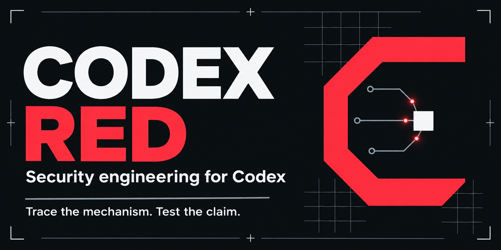

# Codex Red

[](https://github.com/ssstrickys/codex-red/actions/workflows/ci.yml) · [MIT license](LICENSE) · [Latest release](https://github.com/ssstrickys/codex-red/releases/latest)

Domain knowledge for security engineering and reverse engineering in Codex.

Codex Red supplies technical references for native binaries, applications, identity, infrastructure, devices, protocols, cryptography, AI systems and forensic evidence. The relevant knowledge loads for the task at hand.

## Use with Codex

From the project where you want to use the skill:

```bash
mkdir -p .agents/skills
git clone --depth 1 https://github.com/ssstrickys/codex-red.git .agents/skills/codex-red
```

Keep the complete repository together, including `SKILL.md`, `references/`, `assets/` and `agents/`.

| Scope | Skill directory |
| --- | --- |
| Project | `<project>/.agents/skills/codex-red/` |
| User | `$HOME/.agents/skills/codex-red/` |

Resolve an existing skill with the same name before adding another copy. Discovery depends on the host; the current [Codex skills documentation](https://developers.openai.com/codex/skills/) describes supported locations.

Invoke `$codex-red`, for example:

> Use $codex-red to explain the calling convention and memory semantics in this disassembly.

> Use $codex-red to analyze the authorization boundary in this API code.

> Use $codex-red to interpret the event types and timestamps in this audit export.

See [Codex integration](references/codex-integration.md) for skill identity and discovery details.

## Knowledge scope

- Native formats, ISA/ABI semantics, stack and memory behavior, C-language limits and debugger interpretation.
- Application/API authorization, identity, cryptography and AI-system trust boundaries.
- Host privileges, cloud, containers, CI/CD and software-supply-chain properties.
- Mobile, firmware, network, wireless and forensic evidence semantics.

Tools, execution behavior, permissions and required checks come from Codex and the selected project/environment. This package supplies reference knowledge and display metadata. It adds no analysis service, installer, credentials, hooks or model override.

## Package checks and limits

The repository's standard-library scripts check packaging, metadata and local links:

```bash
python3 scripts/check_package.py --release
python3 -m unittest discover -s scripts -p 'test_*.py'
```

These checks validate package structure, not domain expertise or model accuracy. The project makes no established general speed or accuracy advantage claim. Technical behavior depends on the actual platform/version and configuration; use current primary specifications where those details matter.

## Repository layout

| Path | Purpose |
| --- | --- |
| `SKILL.md` | Skill entry point and domain routing |
| `references/` | Technical domain knowledge |
| `scripts/` | Package checker and its tests |
| `assets/` | Project banner and icon |
| `agents/openai.yaml` | Codex display and invocation metadata |

## Provenance and licensing

Codex Red is a custom project for Codex. [PROVENANCE.md](PROVENANCE.md) describes authorship and source scope. Original contributions use the [MIT License](LICENSE); applicable third-party attribution remains in [NOTICE.md](NOTICE.md) and [LICENSE.upstream.txt](LICENSE.upstream.txt).

Codex Red is an independent project for Codex; no vendor affiliation or endorsement is claimed.
